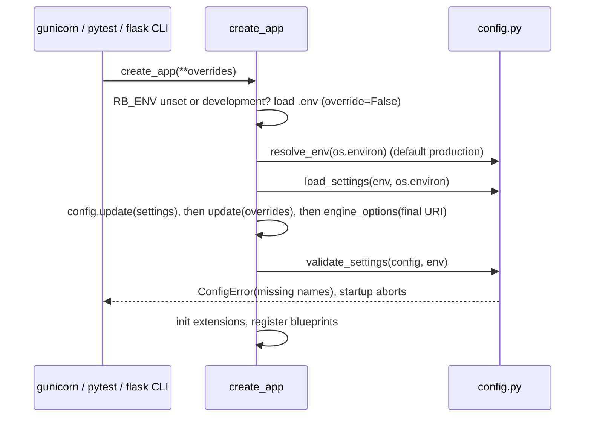
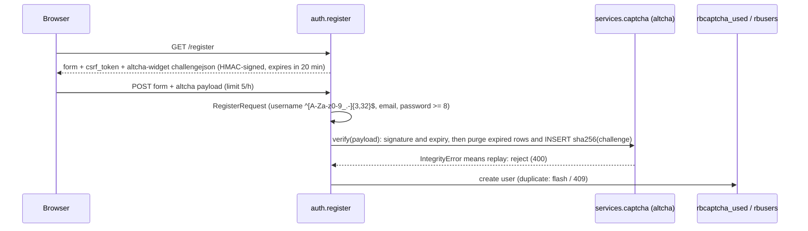

# Design: F0 Foundation (roadmap F0 "Base")

> Inputs: `proposal.md` (with its Approval section), `exploration.md`, `dev-schema-snapshot.txt` (dev DB, PostgreSQL 18.4, the only source for the baseline), `roadmap.md`, and the current code.
> This document is longer than the 800-word skill budget. That is on purpose: the orchestrator asked for 5 units, a file list per unit, and answers to 11 open items. Tables are used wherever possible.

## 1. Technical Approach

We keep the app factory and the per-domain blueprints. We add three thin layers that later phases reuse:

1. **Config.** Settings come only from env. They are resolved by pure functions and checked inside `create_app`, after test overrides are applied.
2. **Schema.** Flask-Migrate/Alembic becomes the only way to change the schema. It starts from an exact copy of the dev DB.
3. **Security services.** `app/security.py`, `app/services/{auth,captcha,pricing,card_images}.py` and `app/utils/clock.py`. Jinja views use them now; `/riftbound/api/v1` uses them in unit e.

Each new protection can be switched off by config. In `testing` they are off: CSRF, the rate limiter and the captcha (`none`). Dedicated fixtures turn them on, so the 93 baseline tests keep working and every unit can be built with strict TDD.

## 2. Architecture Decisions (answers to the open items)

| # | Topic | Decision | Rejected (why) |
|---|---|---|---|
| D1 | `RB_ENV` and `.env` | `RB_ENV` is one of `production`, `development`, `testing`. Default: **`production`**. `create_app` loads `<repo>/.env` (python-dotenv, `override=False`) only when `RB_ENV` is unset or `development`. The `.env` file itself may set `RB_ENV=development`. `tests/conftest.py` sets `RB_ENV=testing` before importing `app`. Note: the `flask` CLI also auto-loads `.env`/`.flaskenv`; that is fine on dev. | Default `development`: a host with no env would start insecure. Raising at import time in `config.py`: breaks tooling and tests. |
| D2 | Fail-fast rules | `validate_settings(cfg, env)` runs after overrides. It raises `ConfigError(RuntimeError)` and lists the missing **names**, never the values. Production needs: `SECRET_KEY` of at least 32 characters and not in the denylist (legacy default, `.env.example` placeholder, `change-me`); `DATABASE_URL`; `DEBUG` false. Development needs `DATABASE_URL`; if `SECRET_KEY` is missing it uses a random key per process and logs a warning. `TESTING=True` skips the checks. | A hard-coded dev DB fallback, which would put a credential back in the code. |
| D3 | Alembic layout | `flask db init` refuses a non-empty directory. So we generate the Flask-Migrate 4.1.0 template with `flask db init -d <scratchpad>` and copy `alembic.ini`, `env.py`, `script.py.mako` and `README` into `migrations/`. Legacy SQL goes to `migrations/legacy_sql/`; Alembic only scans `versions/`. Options live in one module, `app/db_schema.py`, which the drift guard reuses. `env.py` runs `CREATE SCHEMA IF NOT EXISTS riftbound` on PostgreSQL **before** Alembic creates `riftbound.alembic_version`. `Migrate` gets an absolute `directory=`. `.flaskenv` sets `FLASK_APP=wsgi.py`. | Running `flask db init` and then moving the legacy files in: fragile ordering. |
| D4 | Does the baseline include legacy tables? | **Yes.** `0001_baseline` copies the snapshot, including `old1_rbusers`, `old_rbdecks` and the wrong `rbdecks.fk_deck_user → old1_rbusers(rbus_username)`. It has no `has_table` guards. Dev gets `stamp 0001`; every other DB gets `upgrade`. So `0002` (the drop) runs everywhere and CI tests it on SQLite and PostgreSQL. | A baseline without legacy tables: the history would differ per environment, and the drop path would only ever run, untested, on dev. |
| D5 | Baseline fidelity | Column order, constraint and index names, and defaults are copied from the snapshot. The DDL is portable: CHECKs written as `IN (...)` (PostgreSQL rewrites them as `= ANY(ARRAY...)`), `sa.text('CURRENT_TIMESTAMP')` or `sa.func.now()`, `BigInteger().with_variant(Integer,'sqlite')`, `JSON().with_variant(JSONB,'postgresql')`, and the partial index with `postgresql_where` and `sqlite_where`. A new command, `flask schema snapshot`, prints the schema in the same format as the snapshot file. A PostgreSQL test runs it after `upgrade 0001` and diffs the output against `tests/fixtures/dev_schema_snapshot.txt`. It ignores the header line, the `... NOT NULL` constraint-name lines and the legacy sequence name. The same command is run on dev before `stamp`. | An autogenerated baseline: it would describe the models, not the dev DB. |
| D6 | varchar lengths vs Text | **Models match the DB.** Where dev has `varchar(n)` the model uses `String(n)`: all `rbusers` columns, `rbcol_user/condition/language`, `rbdck_user(80)/name(200)/mode,format(50)/max_set(100)`, `rbpcm_foil(1)`. Everything else stays `Text`. Also: `rbdck_seq` becomes `Integer`; `rbdck_mode/format` become nullable with a server default; `password_hash` becomes NOT NULL. The dev names are declared explicitly: `rbusers_{username,email}_key`, `rbdecks_rbdck_user_rbdck_name_rbdck_seq_key`, `idx_rbcollection_*`, `idx_rbcm_*`, the CHECKs `rbcollection_{playset,selling}_chk` and `rbcm_pcm_foil_chk`, and the FKs `rbcards_rbset_fk_1`, `rbcollection_rbcar_fk_1`, `rbcollection_user_fk_1`, `rbcmk_rbcar_fk_1`, `fk_deck_user`. We remove `index=True` where dev has no index. The only DB type change in F0 is quantity. | Converting the DB to `Text` everywhere: DDL churn with no user value now. |
| D7 | Revision chain | Readable revision ids: `0001_baseline`, `0002_drop_legacy_tables`, `0003_collection_quantity_integer` (unit b), `0004_user_admin_flags` (c), `0005_login_protection` (d). Every ALTER uses `op.batch_alter_table`: SQLite recreates the table, PostgreSQL gets a plain ALTER. | Hash ids: the order is unreadable in reviews. |
| D8 | Legacy backup | `0002` refuses offline (`--sql`) mode. It reads the rows with SQLAlchemy and writes `INSERT` statements (compiled with `literal_binds`) to `LEGACY_BACKUP_DIR/legacy_tables_<UTC>.sql`. The default directory is `<instance_path>/backups`, overridable with `RB_LEGACY_BACKUP_DIR`. `instance/` is gitignored. The file gets mode 0600 and is written only when rows exist. Downgrade recreates the tables and replays the newest backup if one exists. | A `pg_dump` subprocess: needs the binary and credentials, only works on PostgreSQL, cannot be tested on SQLite. |
| D9 | Quantity cast | Pre-flight check in Python, so it works on both databases: if any `rbcol_quantity` does not match `^\s*\d{1,9}\s*$`, the migration aborts and lists those `rbcol_id`s. The cast is `postgresql_using='btrim(rbcol_quantity)::integer'`; downgrade casts with `::text`. No DB CHECK in F0: the app already validates 1..9999, and a CHECK would abort on legacy rows with 0. | Silent coercion: it would hide junk left by the old `import_csv`. |
| D10 | Block flag naming | `is_admin` and `is_blocked`, both `BOOLEAN NOT NULL DEFAULT false` and unprefixed like the other `rbusers` columns. A property `User.is_active` returns `not is_blocked`, so Flask-Login 0.6.3 refuses `login_user` and drops existing sessions on the next request. The temporary lock (`locked_until`) is checked only in `services.auth.authenticate`, so a lock never ends a live session. | A column literally named `is_active`: it shadows the Flask-Login attribute and is easy to confuse with "locked". |
| D11 | Admin enforcement and CLI | An `admin_required` decorator (login check, then 403 unless `is_admin`) goes on set/card add and update and on the image upload. `price_bp.before_request(require_admin)` covers all 23 price routes. CLI group `flask users`: `promote <username>` bootstraps the owner; also `demote`, `block`, `unblock`, `set-password` (hidden prompt with confirmation, minimum 8 characters) and `list`. Unit d adds `unlock`. Commands exit with code 1 when the user is unknown. | A role table (RBAC): there is one owner-admin, so YAGNI. Promoting automatically inside a migration. |
| D12 | Pricing module boundary | `app/services/pricing.py` owns the fallback chain (pure `resolve_price`) and the per-card lookup (`canonical_product_id`, which uses the same MIN(id_product) and foil rule as the collection query, and `latest_price_for_card`). Collection keeps its SQL join and only calls `resolve_price`. Deck replaces `_latest_price_for_card`. The chain takes the first non-NULL value, so 0 counts as a price. | Moving the collection join into the service: the query is performance-sensitive and nothing else reuses it yet. |
| D13 | Card images | One rule for reading and writing: `card_image_folder(image, set_id)` uses the filename prefix, else `set_id.lower()`, and the result must match `^[a-z0-9]+$`. `image_src`, the upload route and the Riot scraper all use it. Writes resolve under `static_folder/images/cards` and are rejected if they escape it (`realpath` + `commonpath`). | Keeping `set_id.lower()` on the write side: promo images would break again. |
| D14 | CSRF | Flask-WTF `CSRFProtect` with `WTF_CSRF_TIME_LIMIT=None`; the strict Referer check on HTTPS stays on (ProxyFix already trusts proto and host). `base.html` gets a `<meta name="csrf-token">` and `static/js/csrf.js`, which wraps `fetch`: for same-origin requests with unsafe methods it adds `X-CSRFToken` if missing. Login, register and logout forms get a hidden field. The API blueprint is **not** exempt. | Our own double-submit scheme (security code we would have to own). Relying on SameSite alone. |
| D15 | Rate limit and lockout | Flask-Limiter on `memory://` (overridable with `RATELIMIT_STORAGE_URI`). A shared limit with scope `login`, `10/minute;50/hour`, covers both the Jinja and the API login; register gets `5/hour`. The DB lockout is the real control: the 5th failure sets `locked_until = now + min(15·2^level, 1440)` minutes and then `level+1`; a successful login resets both. A locked account gets **429 + `Retry-After`**: the Jinja view re-renders the login page with status 429, the API returns JSON. Nginx `limit_req` is documented. | Redis: not installed. HTTP 423: a WebDAV code that clients handle poorly. |
| D16 | ALTCHA and replay storage | A provider interface (`none` or `altcha`), chosen by `CAPTCHA_PROVIDER` (`none` in testing). HMAC key: `ALTCHA_HMAC_KEY`, else HMAC-SHA256(SECRET_KEY, "altcha"). **Replays are tracked in a DB table, `rbcaptcha_used`**: `rbcap_hash varchar(64)` primary key (sha256 of the challenge) and `rbcap_expires_at`. Verification inserts the hash or rejects the payload, and purges expired rows each time. Jinja renders the challenge inline (`challengejson`); the widget JS is vendored under `static/vendor/altcha/`. Unit e adds `GET /auth/captcha` for the SPA. | An in-memory set: per worker and lost on restart, so a payload could be reused across 3 workers. Expiry only: replay possible inside the window. |
| D17 | Injectable clock | `app/utils/clock.py: utcnow()` returns naive UTC, matching `timestamp without time zone`. Services call it through the module, so tests can use `monkeypatch.setattr(clock, 'utcnow', ...)`. | freezegun: a new dependency. |
| D18 | JSON vs HTML (unit e) | `wants_json()` is true when the path is under `/riftbound/api/`, or `request.is_json`, or `best_match(['application/json','text/html']) == 'application/json'`. `login.unauthorized_handler` returns JSON 401 when `wants_json()`; otherwise it keeps today's flash and redirects to `auth.login?next=`. | Keeping `accept_json`: it is true for a browser's `*/*`. |
| D19 | Deck lookups | `/deck/view/<name>[/<seq>]` only looks at the viewer's own decks and returns 404 otherwise. Shared decks are viewed through `/deck/view/<id>`, the only form the templates link to. have/missing comes from the viewer's collection. | A global name lookup with a tie-break: it still reveals who owns a name, and the rule is not obvious. |
| D20 | PostgreSQL test lane | Tests marked `@pytest.mark.postgres` run only when `TEST_POSTGRES_URL` is set. The fixture refuses any database whose name does not contain `test`, and drops and recreates schema `riftbound` for each test. CI uses a `postgres:18` service (dev is 18.4). | Running PostgreSQL tests against the dev DB. |
| D21 | Pinned versions (Python 3.12, Flask 3.1.0, SQLAlchemy 2.0.36) | Unit b: `Flask-Migrate==4.1.0`, `alembic==1.20.0`. Unit d: `Flask-WTF==1.3.0`, `Flask-Limiter==4.1.1`, `altcha==2.3.0`. Transitive packages (Mako, WTForms, limits, ...) are pinned to whatever `pip install --dry-run` resolves during apply. If a pin does not resolve, take the newest release compatible with Flask 3.1 and SQLAlchemy 2.0, and record it. | Leaving them unpinned. |
| D22 | Landing feeds (unit d) | An in-process TTL cache on the fetchers in `app/services/scraper.py`: `LANDING_CACHE_TTL`, default 900 s, one cache per worker, protected by a lock, with `clear_cache()` for tests. | Flask-Caching: a new dependency for 6 functions. |

## 3. Units

### Unit a: Config and secrets



`run.py` binds to `RB_HOST` (default `127.0.0.1`). Debug is on only with `FLASK_DEBUG=1` and never in production. This ships in unit a because the Werkzeug debugger is reachable from the LAN today. Commit `1ae1f6e` travels in this PR.

| File | Action | Change |
|---|---|---|
| `config.py` | Modify | `ENVIRONMENTS`, `ConfigError`, `resolve_env`, `load_settings`, `validate_settings`, `engine_options`; remove `Config` and all credential literals |
| `app/__init__.py` | Modify | `_maybe_load_dotenv`, D1/D2 flow, engine options computed from the final URI, ProxyFix counts read from config (`PROXY_FIX_X_FOR/PROTO/HOST`, default 1) |
| `run.py`, `wsgi.py` | Modify | env-driven host, port and debug; add alias `app = application` |
| `.env.example` | Modify | `RB_ENV`, `SECRET_KEY`, `DATABASE_URL=postgresql+psycopg://...`; variables for later units as comments |
| `docs/riftbound.service` | Modify | `EnvironmentFile=/etc/riftbound/riftbound.env` (640 root:www-data); entry point `wsgi:application` |
| `.github/workflows/ci.yml` | Modify | remove `DATABASE_URL`, `SECRET_KEY`, `FLASK_ENV` |
| `tests/conftest.py` | Modify | `os.environ['RB_ENV']='testing'` before `from app import ...` |
| `tests/test_config.py` | Create | default env, denylist, key length, ephemeral dev key, dotenv gating with a temporary `.env`, `create_app` fails fast |

### Unit b: Alembic baseline, legacy tables, integer quantity

Collection changes:
- The merge becomes atomic: `existing.rbcol_quantity = RbCollection.rbcol_quantity + n`.
- `_qty_int` and every `str()` write are removed.
- Sorting by quantity becomes numeric.
- `import_csv` validates each line with `CollectionImportRow` (set, card, foil `N|S`, quantity 1..9999, the card must exist; otherwise the PostgreSQL FK would raise a 500). It keeps the overwrite behaviour. It answers `{success, imported, skipped:[{line, reason}]}`; a body that is not JSON gets 400.

```mermaid
sequenceDiagram
  participant A as flask db upgrade
  participant M as 0002_drop_legacy_tables
  participant DB as schema riftbound
  participant FS as LEGACY_BACKUP_DIR
  A->>M: upgrade()
  M->>M: offline mode? abort
  M->>DB: rbdecks.rbdck_user values not in rbusers.username?
  M-->>A: orphans found: RuntimeError(list), nothing changed
  M->>DB: (user, name) in old_rbdecks but missing from rbdecks
  M-->>A: log a WARNING per missing deck (no abort)
  M->>DB: SELECT rows from old1_rbusers, old_rbdecks
  M->>FS: if rows > 0, write legacy_tables_<UTC>.sql (INSERTs, mode 0600)
  M->>DB: batch rbdecks: drop fk_deck_user; add fk_deck_user to rbusers(username) ON UPDATE CASCADE ON DELETE RESTRICT
  M->>DB: DROP old_rbdecks, old1_rbusers; on PostgreSQL also DROP SEQUENCE IF EXISTS rbusers_rbus_id_seq
```

PostgreSQL accepts an FK from `varchar(80)` to `varchar(64)`, so the column is not resized.

| File | Action | Change |
|---|---|---|
| `requirements.txt` | Modify | add Flask-Migrate, alembic (and Mako) |
| `.flaskenv`, `.gitignore` | Create / Modify | `FLASK_APP=wsgi.py`; ignore `instance/` |
| `app/__init__.py` | Modify | `migrate = Migrate()`, `init_app(app, db, directory=<abs>, **MIGRATE_OPTIONS)`, `register_cli(app)` |
| `app/db_schema.py` | Create | `SCHEMA`, `include_name`, `MIGRATE_OPTIONS` |
| `app/cli/__init__.py`, `app/cli/schema.py` | Create | `register_cli`; `flask schema snapshot` (reads pg_catalog, prints snapshot text) |
| `migrations/{alembic.ini,env.py,script.py.mako,README}` | Create | D3 |
| `migrations/versions/0001_baseline.py` | Create | 16 tables, per D4 and D5 |
| `migrations/versions/0002_drop_legacy_tables.py` | Create | diagram above; downgrade per D8 |
| `migrations/versions/0003_collection_quantity_integer.py` | Create | D9 |
| `migrations/database/*`, `migrations/install_db.sql`, `docs/database_setup.sql` | Move (`git mv`) | to `migrations/legacy_sql/`, plus a `README.md` saying "frozen, replaced by 0001" |
| `app/models/{user,card,collection,deck,market,cardmarket}.py` | Modify | match the DB (D6); quantity becomes `Integer` |
| `app/routes/domains/collection.py`, `deck.py` | Modify | integer quantity, atomic merge, import validation |
| `app/schemas/validators.py` | Modify | `CollectionImportRow` |
| `run.py` | Modify | remove `db.create_all()` |
| `pytest.ini` | Modify | register the `postgres` marker |
| `tests/conftest.py` | Modify | fixtures `migration_app` (no `create_all`, `LEGACY_BACKUP_DIR=tmp_path`) and `pg_url` |
| `tests/test_migrations.py` | Create | on SQLite: upgrade/downgrade round trip; drift guard (`compare_metadata` with `MIGRATE_OPTIONS` returns nothing); 0002 backup, warning and orphan abort; 0003 pre-flight and cast |
| `tests/test_migrations_pg.py` | Create | baseline matches the snapshot, `USING` cast, FK repoint, `flask db check` is clean |
| `tests/fixtures/dev_schema_snapshot.txt` | Create | copy of `dev-schema-snapshot.txt` |
| `tests/test_collection_quantity.py` | Create | numeric sort, atomic merge, import validation |

### Unit c: Admin authorization and data exposure

| File | Action | Change |
|---|---|---|
| `migrations/versions/0004_user_admin_flags.py` | Create | `is_admin`, `is_blocked` with `server_default=sa.false()` |
| `app/models/user.py` | Modify | the two columns and the `is_active` property (D10) |
| `app/security.py` | Create | `admin_required`, `require_admin` |
| `app/cli/users.py`, `app/cli/__init__.py` | Create / Modify | D11 |
| `app/routes/domains/sets.py`, `cards.py` | Modify | `@admin_required`; upload uses `card_image_path` |
| `app/routes/domains/price.py` | Modify | `before_request` guard; validate `CardmarketLoad` and its override URLs (400 if invalid) |
| `app/services/cardmarket_loader.py` | Modify | `validate_override_url`: https only, host in `CARDMARKET_ALLOWED_HOSTS`, no userinfo, port 443 or none |
| `app/services/pricing.py`, `app/services/card_images.py` | Create | D12, D13 |
| `app/models/card.py`, `app/services/riot_scraper.py` | Modify | `card_image_folder`; the scraper writes through `card_image_path` |
| `app/routes/domains/collection.py` | Modify | use `pricing.resolve_price` (remove `_resolve_price`) |
| `app/routes/domains/deck.py` | Modify | have/missing from the viewer, the pricing service, name lookups limited to the viewer's decks, remove `update/<set>/<card>` and `delete/<set>/<card>`, `versions` returns `id,name,seq,snapshot,mode,format,ncards` |
| `app/routes/domains/profile.py`, `app/schemas/validators.py` | Modify | duplicate email gives 409 (pre-check, plus `IntegrityError` with rollback); `ProfileUpdate.current_password` is required when `password` is sent; minimum password length 8 |
| `config.py` | Modify | `CARDMARKET_ALLOWED_HOSTS=('downloads.s3.cardmarket.com',)` |
| `app/templates/{base,dashboard,sets,cards,profile}.html` | Modify | wrap Price, Add/Edit and Upload in ``; add a current-password input |
| `tests/conftest.py` | Modify | `make_user`; `admin_client` and `other_user_client`, each with its own `app.test_client()` |
| `tests/test_routes.py`, `tests/test_cardmarket_ignored.py` | Modify | about 14 tests move to `admin_client`; `test_update_password` sends `current_password` |
| `tests/test_authz_matrix.py` | Create | every endpoint in `url_map` must appear in a public/user/admin table (`price.*`, `landing.*` as wildcards); checks anonymous 302/401, user 403, admin allowed; `requests.Session.request` is monkeypatched so no real network call happens |
| `tests/test_{admin_cli,card_images,pricing,deck_viewing,profile,cardmarket_urls}.py` | Create | one file per capability |

### Unit d: CSRF, login hardening, cookies

```mermaid
sequenceDiagram
  participant B as Browser / SPA
  participant V as auth.login (Jinja) or api_v1 login
  participant L as Flask-Limiter
  participant S as services.auth.authenticate
  participant U as rbusers
  B->>V: POST credentials + CSRF token
  V->>L: shared limit "login" per IP
  L-->>B: 429 + Retry-After when exceeded
  V->>V: LoginRequest validation (400 if invalid)
  V->>S: authenticate(username, password)
  alt unknown user
    S-->>V: dummy hash check, INVALID
  else locked_until > clock.utcnow()
    S-->>V: dummy hash check, LOCKED(retry_after)
  else wrong password
    S->>U: failed_login_count+1; at 5: set locked_until (D15), level+1, count=0
    S-->>V: INVALID (the next attempt gets LOCKED)
  else is_blocked
    S-->>V: BLOCKED
  else correct
    S->>U: reset count, level and locked_until; last_login_at=now
    S-->>V: OK(user)
  end
  V-->>B: OK: login_user + 302/200 · INVALID: 401/flash · LOCKED: 429+Retry-After · BLOCKED: 403/flash
```



| File | Action | Change |
|---|---|---|
| `requirements.txt` | Modify | add Flask-WTF, Flask-Limiter, altcha (and their transitive pins) |
| `config.py` | Modify | cookies (`SAMESITE='Lax'`, `HTTPONLY`, `SECURE` true in production; same for `REMEMBER_COOKIE_*`), `WTF_CSRF_*`, `RATELIMIT_*`, `LOGIN_MAX_FAILURES=5`, `LOGIN_LOCK_BASE_MINUTES=15`, `LOGIN_LOCK_MAX_MINUTES=1440`, `CAPTCHA_PROVIDER`, `ALTCHA_*`, `LANDING_CACHE_TTL`; log a warning when a kill switch is off outside testing |
| `app/__init__.py` | Modify | `csrf = CSRFProtect()` and `limiter = Limiter(get_remote_address)` as module singletons (same pattern as `db`), initialised in the factory |
| `app/utils/__init__.py`, `app/utils/clock.py` | Create | D17 |
| `app/services/auth.py`, `app/services/captcha.py` | Create | section 4 |
| `app/models/user.py` | Modify | `failed_login_count`, `lockout_level` (`INTEGER NOT NULL DEFAULT 0`), `locked_until`, `last_login_at` (nullable) |
| `app/models/captcha.py`, `app/models/__init__.py` | Create / Modify | `RbCaptchaUsed` (+ `idx_rbcaptcha_used_expires`) |
| `migrations/versions/0005_login_protection.py` | Create | lockout columns and the `rbcaptcha_used` table |
| `app/routes/auth.py`, `app/schemas/validators.py` | Modify | use the services with `LoginRequest`/`RegisterRequest`; limiter decorators; logout accepts POST only |
| `app/errors.py`, `app/templates/errors/429.html` | Modify / Create | `CSRFError` gives 400; 429 keeps `Retry-After` |
| `app/cli/users.py` | Modify | `unlock` resets count, level and `locked_until` |
| `app/services/scraper.py` | Modify | D22 |
| `app/templates/{base,login,register}.html` | Modify | meta tag and `csrf.js`; logout as a POST form; hidden token; altcha widget |
| `app/static/js/csrf.js`, `app/static/vendor/altcha/{altcha.min.js,LICENSE}` | Create | D14; vendored widget, pinned version |
| `docs/nginx_config` | Modify | `limit_req_zone`/`limit_req` for login, register and `/riftbound/api/v1/auth/` |
| `tests/conftest.py` | Modify | fixtures `csrf_app`, `limited_app` (calls `limiter.reset()` on teardown), `altcha_app` (`ALTCHA_MAX_NUMBER=1000`), `frozen_clock` |
| `tests/test_{csrf,templates_csrf,login_protection,captcha,session_cookies,landing_cache}.py` | Create | `templates_csrf` checks that every non-landing template extends `base.html` and that the rendered page has the meta tag |

### Unit e: API v1, CI, docs, cleanup

| Method | Path (prefix `/riftbound/api/v1`) | Auth | `data` on success | Errors |
|---|---|---|---|---|
| GET | `/health` | public | `{status, db, version}` | 503 if the DB is down |
| GET | `/meta/config` | public | `{env, registration_open, captcha:{provider, required_for:['register']}, csrf:{header:'X-CSRFToken'}}` | none |
| GET | `/auth/session` | public | `{authenticated, user?, csrf_token}` | none |
| GET | `/auth/captcha` | public | `{provider, challenge}` | none |
| POST | `/auth/login` | public, CSRF | `{user}` | 400, 401, 403, 429 |
| POST | `/auth/logout` | user | `{}` | 401 |
| POST | `/auth/register` | public, CSRF, captcha | `{user}` (201) | 400, 409, 429 |

`user` is `{id, username, email, is_admin}`.

CI:
- Workflow-level `permissions: contents: read`. Triggers: push to `main` and pull requests to `main`.
- Job `test`: Python 3.12, pip cache, coverage report uploaded as an artifact.
- Job `migrations-pg`: service `postgres:18`, `RB_ENV=development`. Steps: `flask db upgrade`, `check`, `downgrade base`, `upgrade` again, then `pytest -m postgres`.
- Job `frontend`: GitHub does not allow `hashFiles` in a job-level `if`, so a step checks for `frontend/package.json` and the Node steps run only when it exists. Until F1 the job does nothing.

| File | Action | Change |
|---|---|---|
| `app/api/__init__.py`, `app/api/responses.py`, `app/api/v1/{__init__,meta,auth}.py` | Create | blueprint `api_v1`; endpoints use `@validate_json` and the auth/captcha services |
| `app/errors.py`, `app/__init__.py` | Modify | `wants_json` (D18); one JSON format for every `HTTPException` (405, 415, ...); register the API; `unauthorized_handler` |
| `config.py` | Modify | `APP_VERSION` from `RB_VERSION` (default `dev`) |
| `.github/workflows/{ci,security,release}.yml` | Modify | jobs above; bandit pinned on Python 3.12; release gets `contents: write` |
| `.python-version`, `.gitignore` | Create / Modify | `3.12`; ignore `node_modules/`, `frontend/dist/`, `.vite/` |
| `AGENTS.md`, `README.md`, `docs/nginx_config` | Modify | real stack and runbook; `/` and `/riftbound/` both proxied to Flask on :8000 |
| `docs/riftbound-landing.service`, `package.json`, `package-lock.json`, `diagnose.py` | Delete | obsolete |
| `tests/test_api_v1.py`, `tests/test_error_negotiation.py` | Create | envelope, JSON 401, browser 404 returns HTML, `/api/v1/x` returns JSON 404 |

## 4. Interfaces / Contracts

```python
# config.py
class ConfigError(RuntimeError): ...
def resolve_env(environ: Mapping[str, str]) -> str            # default 'production'
def load_settings(env: str, environ: Mapping[str, str]) -> dict[str, Any]
def validate_settings(cfg: Mapping[str, Any], env: str) -> None

# app/db_schema.py
MIGRATE_OPTIONS = dict(version_table_schema='riftbound', include_schemas=True,
                       compare_type=True, include_name=include_name)  # schema filter: only 'riftbound'

# app/services/auth.py
class AuthStatus(StrEnum): OK = 'ok'; INVALID = 'invalid'; LOCKED = 'locked'; BLOCKED = 'blocked'
@dataclass(frozen=True)
class AuthResult: status: AuthStatus; user: User | None = None; retry_after: int | None = None
def authenticate(username: str, password: str) -> AuthResult
def register_user(data: RegisterRequest) -> User                  # raises DuplicateUserError
def unlock_user(username: str) -> bool

# app/services/captcha.py
class CaptchaProvider(Protocol):
    name: str
    def challenge(self) -> dict | None: ...
    def verify(self, payload: str | None) -> bool: ...         # also rejects replays (rbcaptcha_used)
def get_captcha_provider() -> CaptchaProvider

# app/services/pricing.py
def resolve_price(price_row, *, rarity: str | None, foil: str | None) -> float | None
def canonical_product_id(rbset_id: str, rbcar_id: str, foil: str = 'N') -> int | None
def latest_price_for_card(rbset_id: str, rbcar_id: str, *, rarity: str | None, foil: str = 'N') -> float | None

# app/models/card.py, app/services/card_images.py
def card_image_folder(image: str | None, set_id: str | None) -> str          # '' when invalid
def card_image_path(static_folder: str, image: str, set_id: str | None) -> str  # ValueError if it escapes the folder

# app/api/responses.py
def ok(data=None, *, meta=None, status=200, headers=None) -> Response        # {success: true, data, meta}
def fail(error, message, status, *, details=None, headers=None) -> Response  # {success: false, error, message, details?}
```

## 5. Testing Strategy

| Layer | What | How |
|---|---|---|
| Unit | config functions, the price chain, image folder and path rules, URL allow-list, the `authenticate` states, captcha provider, TTL cache | pure functions; monkeypatched clock; altcha challenges solved inside the test with a low `max_number` |
| Integration (SQLite) | routes, authorization matrix, CSRF/limiter/captcha through dedicated fixtures, CLI via `app.test_cli_runner()`, migrations up and down, drift guard | Flask test client; in-memory SQLite with `riftbound` attached (exploration spikes 1 and 2) |
| Integration (PostgreSQL) | baseline fidelity, `USING` cast, FK repoint, `flask db check` | `postgres` marker plus `TEST_POSTGRES_URL`; CI `postgres:18` |
| Manual | Nginx `limit_req`; Secure cookie and Referer check behind HTTPS; stamp and upgrade on dev | runbook in each PR description |

## 6. Migration / Rollout

| Unit | Dev rollout | Rollback |
|---|---|---|
| a | Write `.env` (`RB_ENV=development`, `DATABASE_URL`, `SECRET_KEY`) and set the service `EnvironmentFile` before deploying | Revert the PR |
| b | `pg_dump -n riftbound -Fc` to a path outside the repo; diff `flask schema snapshot` against the fixture; `flask db stamp 0001`; `flask db upgrade`; `flask db check` | `flask db downgrade 0001` (replays the backup), `flask db stamp base`, revert; or restore the dump |
| c | `flask db upgrade`, then `flask users promote <owner>`, then restart | `flask db downgrade 0003`, revert |
| d | `flask db upgrade`; kill switches `WTF_CSRF_ENABLED=false`, `RATELIMIT_ENABLED=false`, `CAPTCHA_PROVIDER=none`; `flask users unlock` | `flask db downgrade 0004`, revert |
| e | Nothing to run; only adds files | Revert |

## 7. Open Questions (none block tasks)

- [ ] The attempt that reaches the 5th failure returns INVALID, and the next attempt returns LOCKED. This matches "the 6th failed login locks". The spec may prefer LOCKED on the 5th attempt itself.
- [ ] The current password is required only to change the password, not the email. The spec should confirm.
- [ ] `import_csv` keeps overwriting quantities (today's behaviour). F3 replaces the importer.
