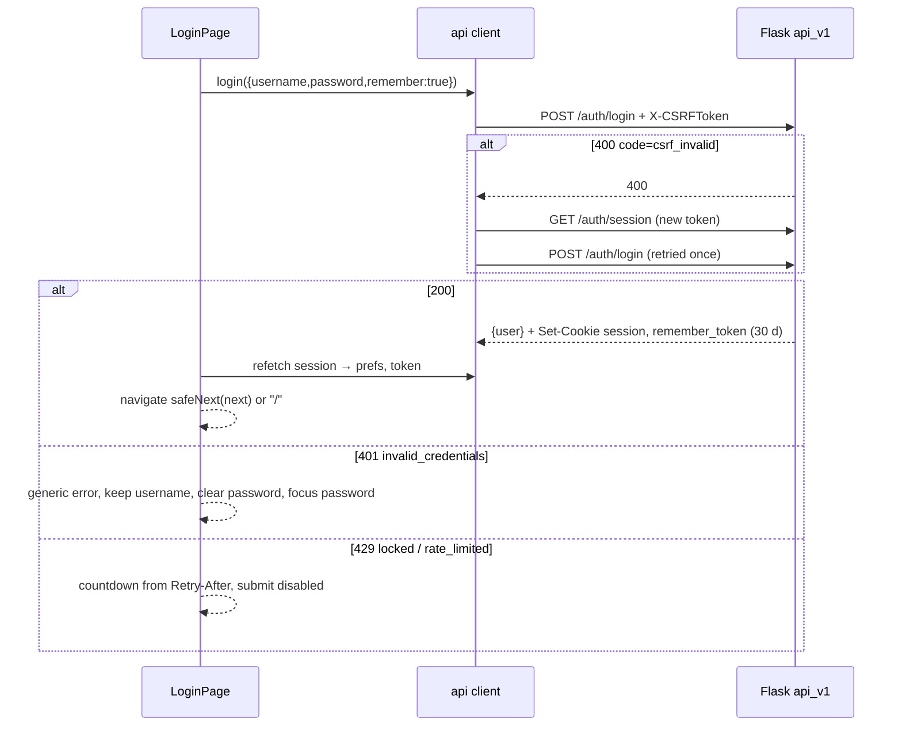
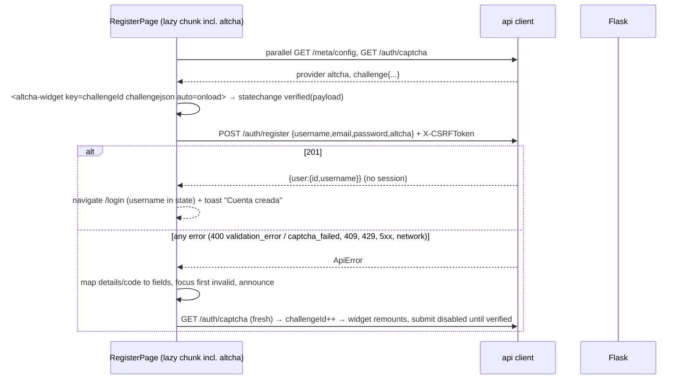
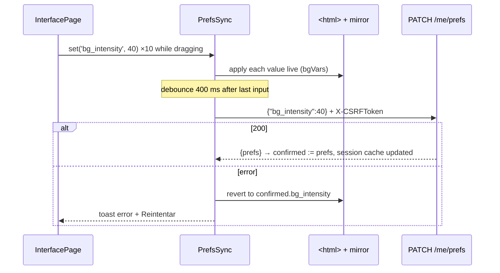

# Design: F1 App Shell (roadmap F1 "Estructura app")

> Inputs: `proposal.md` (with the 2026-10-19 background addendum and "Rift Manager" branding), `exploration.md`,
> `openspec/design-handoff.md`, the specs in `specs/` (HOST, PREF, FAUTH, I18N, DS, SHELL, PWA, API-1/4/5/9, SESS-1,
> CI-5/9), the current Flask code and tests, the prototype (read only) and `brand/`.
> This document is longer than the 800-word skill budget. That is on purpose, as in F0: the orchestrator asked for
> seven units, file lists, five sequence diagrams and answers for every open item. Tables are used where possible.

## 1. Technical Approach

Two independent lanes that meet through the JSON API and four small contract files:

1. **Backend (Flask).** Two additions, nothing removed. `spa_bp` serves the Vite build from `FRONTEND_DIST` at
   `/riftbound/app/`. The API gains `rbuserprefs` (`0006_user_prefs`), `GET`/`PATCH /me/prefs`, `prefs` in the
   session payload, `remember` on login (30-day cookie), and optional `code`/`params` on errors. The Jinja app is
   untouched apart from a "Nueva app" link and the rename to "Rift Manager".
2. **Frontend (`frontend/`).** A Vite 8 / React 19 / TS 6 SPA. React Router 8 data mode (basename `/riftbound/app`),
   TanStack Query 5 as the only server-state store, react-i18next with bundled catalogs, plain-CSS tokens in
   `@layer` plus CSS Modules, and vite-plugin-pwa `generateSW` in prompt mode.
3. **Contracts between the lanes.** These are checked by pytest, so the Python lane never needs Node (CI-9):
   - the `altcha` pin in JS equals the pin in Python;
   - `legacy-routes.json` matches the Flask `url_map`;
   - every backend error `code` has an ES and an EN catalog entry;
   - `spa_bp` behaviour is tested against a temporary dist.

Delivery follows the proposal: a, b, c in parallel, then d, e, f, g. Strict TDD on both lanes: pytest for b and c,
Vitest for a, d, e, f. Every unit is deployable on its own and leaves Jinja working.

## 2. Architecture Decisions

| # | Topic | Decision | Rejected (why) |
|---|---|---|---|
| D1 | Hosting | Flask `spa_bp` serves `FRONTEND_DIST` (default `<repo>/frontend/dist`, env override, read **per request** so tests can point it at a tmp dir). Nginx does not change and keeps its 2 `proxy_pass` lines. | Nginx static location: the proxy runs on another host, that host has no access to the dist, and the nginx doc test forbids it now. Deferred to F12. |
| D2 | Routing rules | Rule `/riftbound/app/` → `index.html`. Werkzeug's strict-slash rule turns `/riftbound/app` into a 308 to `/riftbound/app/`. Rule `/riftbound/app/<path:path>`: (1) if the file exists in dist (`send_from_directory`, which uses `safe_join`) it is served; (2) if the last segment matches `\.[A-Za-z0-9]{1,8}$` the answer is **404**; (3) otherwise `index.html` (a client route). | Serving `index.html` for every miss: a missing hashed chunk would come back as HTML, and the browser would show a cryptic MIME error. |
| D3 | Cache headers | `assets/*`: `public, max-age=31536000, immutable`. Everything else (`index.html`, the fallback, `sw.js`, `workbox-*.js`, `registerSW.js`, `manifest.webmanifest`, icons, favicon): `no-cache`, served with `conditional=True` and ETag so revalidation gets a 304. Every SPA response also gets `X-Content-Type-Options: nosniff` and `Referrer-Policy: strict-origin-when-cross-origin`; the CSRF Referer check needs that referrer policy. | Short `max-age` on icons: they are precached anyway, and `no-cache` is simpler to reason about. |
| D4 | Mimetypes | A `SPA_MIMETYPES` map (`.webmanifest` → `application/manifest+json`, `.woff2` → `font/woff2`, `.webp` → `image/webp`, `.js` → `text/javascript`, `.svg` → `image/svg+xml`) is passed explicitly to `send_from_directory`. | `mimetypes.add_type` at import: it is process-global and depends on the host's `/etc/mime.types`. |
| D5 | SPA errors | `_spa_error(status, message)`: when `wants_json()` (API-8: script and fetch requests send `*/*`) the answer is `json_error`; otherwise a **minimal inline HTML** page that does not extend `base.html`. Used for the 404 of D2 and for the 503 when there is no `index.html` (HOST-5, `Cache-Control: no-store`). The app always starts. | `abort()` with the Jinja error pages: `base.html` calls `csrf_token()` and `current_user`, so the response would write the session and send a `Set-Cookie`. |
| D6 | Prefs storage | 1:1 table `riftbound.rbuserprefs`, typed nullable columns (NULL = Auto) and **named CHECKs**. The row is created lazily on the first PATCH. There is no ORM relationship on `User`; access goes through `app/services/prefs.py`. | Columns on `rbusers`: UI state would live in the hot auth table. A JSON column: no DB validation. |
| D7 | PATCH semantics | `PrefsUpdate` (Pydantic, `extra='ignore'`) with `Literal[...] \| None` fields and `bg_intensity: Annotated[StrictInt, Field(ge=0, le=100)] \| None`. The service applies `model_fields_set` only, so an absent field stays unchanged and `null` resets to Auto. An empty body `{}` returns 200 and changes nothing. It is all-or-nothing because validation runs before any write. Upsert: SELECT, then INSERT or UPDATE; an `IntegrityError` on a concurrent first insert is retried once as an UPDATE. | `extra='forbid'`: a newer SPA talking to an older server during a deploy would get a 400 for the whole request. Lax `int`: it accepts `true` and `50.0` (PREF-4 forbids both). |
| D8 | Remember cookie | `LoginRequest.remember: StrictBool = False`, then `login_user(user, remember=...)`. `REMEMBER_COOKIE_DURATION = timedelta(days=30)` is a constant in `_session_settings` (no env var). The expiry is **absolute** (`REMEMBER_COOKIE_REFRESH_EACH_REQUEST` stays False). Flask-Login's `logout_user` already expires the cookie. The Jinja login is unchanged (the schema default is False). | An env-configurable duration: one more variable to document and test, with no request for it. Sliding expiry: a stolen cookie would live for ever as long as it is used; revisit with server-side sessions in F9. Lax `bool`: it accepts `"yes"`, and the API-5 scenario forbids that. |
| D9 | Error codes (API-9) | `json_error`/`fail` get keyword-only `code=None, params=None` (added only when set). Constants live in `app/api/error_codes.py` (`ErrorCode(StrEnum)`): `invalid_credentials`, `locked`, `rate_limited`, `username_taken`, `email_taken`, `captcha_failed`, `csrf_invalid`, `unauthenticated`, `validation_error`. Three **global** handlers get a code because they are the only place those errors are produced: CSRF (`csrf_invalid`), 429 (`rate_limited` + `params.retry_after`) and `unauthorized_handler` (`unauthenticated`). `validate_json` adds `code:"validation_error"` and, in each `details[]` item, `code` + `params` from a mapping of Pydantic error types (§5.3). `RegisterRequest` validators raise `PydanticCustomError('invalid_format', ...)` so the type is specific; the Jinja `removeprefix('Value error, ')` keeps working. | A separate `api_validate_json`: it would duplicate the decorator. Adding codes to every 404/405/500: the client already falls back by HTTP status (I18N-4). |
| D10 | Frontend structure | Feature folders with one-way dependencies, enforced by ESLint `no-restricted-imports` overrides (§3): `lib` and `components/ui` are pure; `api` depends only on `lib`; features (`auth`, `prefs`, `i18n`, `pwa`, `shell`, `account`) depend downward; only `app/` wires everything together. Alias `@/` → `src/` (tsconfig `paths` without `baseUrl`, plus Vite `resolve.alias`). | Layer folders (`hooks/`, `pages/`): features would be spread across trees. `eslint-plugin-import`: another plugin pinned for a rule that core ESLint already covers. |
| D11 | Server state | TanStack Query is the single cache. `['session']` holds `{authenticated, user, prefs}` (`staleTime` 5 min, refetch on window focus, so a logout in Jinja or another tab is picked up). The CSRF token is **not** in the cache; it lives in a module variable in `api/csrf.ts` (FAUTH-1). Retries: none on 4xx, one on a network error. | Redux/Zustand: there is no client-only global state in F1 beyond prefs, and prefs fit in a context. |
| D12 | API client | `api.request<T>(path, {method, body, signal})` is a typed `fetch` wrapper: base `VITE_API_BASE` (default `/riftbound/api/v1`), `credentials:'same-origin'`, `Accept: application/json`, a JSON body, a 15 s timeout (`AbortSignal.any`). It unwraps the envelope and throws `ApiError {kind:'http'\|'network'\|'timeout'\|'parse', status, error, code, params, message, details, retryAfter}`. `code` is normalised (`body.code ?? deriveCode(error, status)`), so F0-shaped bodies still map. Unsafe methods attach `X-CSRFToken` (fetching the session first if no token is held). **CSRF retry once** (FAUTH-6): on 400 with `code==='csrf_invalid'` it calls `refreshSession()` (new token and new auth state) and repeats the request exactly once with a `retried` flag. **401**: every path except `/auth/login` and `/auth/logout` calls the registered `onUnauthorized` hook (§4.2). **429**: `retryAfter` is taken from the `Retry-After` header, else `params.retry_after`. The ALTCHA payload is safe to resend on the CSRF retry, because CSRF rejects the request before the captcha is verified. | axios or ky: `fetch` covers it, with no extra dependency or CSP surface. |
| D13 | Routing and guards | `createBrowserRouter` with basename `/riftbound/app`, lazy route modules, a `HydrateFallback` loading screen and an `errorElement` per layout. The loaders `requireAuth`, `requireAnon` and `requireAdmin` (§4.3) run `queryClient.ensureQueryData(sessionQuery)`. `next` is always an **absolute** path (`/riftbound/app/...`) so it is the same shape as Jinja's `next`, and `safeNext` (FAUTH-9) decides between a router navigation and a full navigation. | Guard components inside the tree: the login form would flash before the redirect (FAUTH-1 forbids it). |
| D14 | i18n | i18next + react-i18next, catalogs imported statically (they are bundled and precached), namespaces `common, nav, auth, errors, prefs`. `errors.json` holds `code.*`, `status.*` and `validation.*` so the five spec namespaces are enough. Resources are typed (`CustomTypeOptions.resources = typeof es`): ES is the source, and a missing key fails `tsc`. The parity test covers EN. The language is resolved by our own pure `resolveLang()` (§4.5); `fallbackLng:'es'`, `returnNull:false`. Locales `es-ES` / `en-GB` in `lib/format.ts`. | `i18next-browser-languagedetector`: its order cannot express "account pref → `rb_lang` → browser" without plugins. FormatJS: heavier, and needs ICU syntax in catalogs. |
| D15 | CSS architecture | `styles/index.css` declares `@layer reset, tokens, base, layout, components, utilities`. Each **`*.module.css` wraps its rules in `@layer components { }`**; a Vitest scan enforces it, because unlayered CSS beats every layer. Tokens are copied from handoff §1.1. `[data-accent]` and `[data-density]` blocks sit on `<html>`; "regular" is the absence of `data-density`. Interactive tints use `color-mix(in srgb, var(--accent) N%, transparent)` through tokens `--accent-soft` (16%), `--accent-ring` (45%) and `--accent-glow` (50%). z-scale tokens: `--z-bg:-2`, `--z-popover:30`, `--z-topbar:40`, `--z-botnav:50`, `--z-modal:80`, `--z-toast:90`. | vanilla-extract or Tailwind: new toolchain, and lower fidelity to `riftbound.css`. |
| D16 | Breakpoints | `lib/breakpoints.ts` exports `{sm:680, md:860, lg:960, xl:1240, '2xl':1600}`, `up(bp) = (min-width: bp px)` and `down(bp) = (max-width: bp-0.02 px)`, mobile-first (DS-4). The shell **mounts** the top nav or the bottom nav through `useMediaQuery(up('md'))` (`useSyncExternalStore`), so tests can assert DOM presence. Auto density and Auto view use `down('md')`, which means **< 860 px** (see R1). | CSS-only hiding: SHELL-1/3 ask for "not present in the DOM", and screen readers would still walk the hidden nav without `display:none` discipline. |
| D17 | Overlays and toasts | Modal, Sheet and ConfirmDialog use a native `<dialog>` with `showModal()`. That gives the focus trap, Esc and the top layer. A backdrop click closes only when both `pointerdown` and `pointerup` land on the dialog element itself. Scroll lock: `html:has(dialog[open]){overflow:hidden}`. Focus returns to the opener. The **toast stack is a `popover="manual"` element** that is re-shown (`hidePopover()` + `showPopover()`) on every push, so it sits above an open dialog in the top layer. Announcements go through a separate, always-mounted, visually hidden `aria-live="polite"` `LiveAnnouncer`, because content in a newly shown popover is announced unreliably. Fallback: `position:fixed; z-index:var(--z-toast)`. | A z-index-only toast: it can never paint above a top-layer `<dialog>`. Portals plus a hand-written focus trap: that is what the native element already does. |
| D18 | Prefs bootstrap | `main.tsx`, **before** `createRoot().render()`: read `rb_prefs_v1` (validated; corrupt or out-of-domain values are dropped), resolve it against the viewport and `navigator.languages`, and apply `data-density`, `data-accent`, `lang` and the background variables to `<html>`. `index.html` carries an inline `<style>html{background:#06222c;color-scheme:dark}</style>` so nothing white appears before the CSS. No inline script (it would need a CSP hash in unit g, and nothing is painted before React anyway). | A blocking inline bootstrap script: CSP cost, and duplicated logic outside the tested TS. |
| D19 | Background | Overlay gradients are **data** in `lib/background.ts` (`BG_OVERLAYS`), serialised once into `--bg-overlay`, so the contrast test and the CSS use the same source. `bgVars(p)` is defined in §4.6. Blur is applied at **runtime** (`filter`) on a fixed `::before` layer with `inset:-3%` (blurred edges stay off-screen). At 0 % the layer gets `data-bg="off"` → `display:none`, so the image is never downloaded. Mobile variant: `new_rift-1280.webp` under `@media (max-width: 859.98px)`, 1920 above; both are precached. | Pre-blurring the asset at build time: smaller and cheaper, but the blur could no longer be tuned without regenerating files. Kept as an F11 performance option. `image-set` alone: it chooses by pixel density, not by viewport width (R5). |
| D20 | Brand pipeline | The originals go to `frontend/assets-src/brand/` (never shipped). `npm run brand:trace` (`scripts/brand-trace.mjs`, run by hand, **not in CI**): sharp builds a silhouette by "distance from white", `potrace` traces it, svgo cleans it, and the gradients are re-applied as SVG `linearGradient`s sampled from the original (mark: diagonal `#fbb20b` → `#f5500a`; letters: vertical `#f2a90f` → `#e85d07`; the colours are re-sampled by the script). The viewBox is cropped to the bounding box, and the result gets a hand review. Outputs: `src/assets/brand/{mark.svg, wordmark.svg, mark-simple.svg}`. `mark-simple.svg` is traced after a morphological dilation of about 2 % with a higher `turdSize`, so the thin swirl tips survive at 16–32 px; it becomes the favicon and needs the user's sign-off in the PR. **Fallback** if the trace is not acceptable: true colour-to-alpha against white (`α = max_c(255−c)/255`, `c' = (c − (1−α)·255)/α`) into WebP/PNG, which avoids halos better than a threshold. | A system `potrace` binary: not reproducible. Online vectorisers: licence and privacy. A threshold-and-transparent raster: it leaves the white fringe the proposal warns about. |
| D21 | Icons | `@vite-pwa/assets-generator` with `pwa-assets.config.ts` (`npm run icons`). Source: `mark.svg`, plus `mark-simple.svg` for the favicon. Presets: `transparent` 64/192/512 on `#06222c` with 10 % padding; `maskable` 512 with full-bleed `#06222c` and 30 % padding (the mark stays inside the 80 % safe zone); `apple` 180 with 20 % padding on `#06222c`; `favicon.ico` 48 from the simple mark, plus `favicon.svg`. The outputs in `public/` are **committed**. CI only checks them (`check-dist`). | Generating icons in CI: sharp time and non-deterministic PNG bytes on every build. |
| D22 | ALTCHA in React | npm `altcha@2.3.0` is imported **only** in the lazy register route module. `<altcha-widget challengejson auto="onload" hidelogo strings=…>` is wrapped in `AltchaWidget`. A ref plus `addEventListener('statechange')` reads `detail.state`/`detail.payload`, so the code does not depend on how React 19 maps custom-element events. After any failure, and on the `expired` state, the challenge is refetched and the widget is **remounted** with `key={challengeId}`; that is a reset without relying on imperative widget methods. JSX typing goes in `auth/altcha.d.ts`. | A vendored copy of the Jinja widget through a `<script>`: no lockfile, and two loading paths. altcha 3.x: PoW v2, which is incompatible with the Python 2.3.0 pin. |
| D23 | PWA | vite-plugin-pwa 1.3.0, `strategies:'generateSW'`, `registerType:'prompt'`, `injectRegister:false`, registration done from `pwa/useUpdatePrompt.ts` (`virtual:pwa-register/react`). `devOptions.enabled:false`. `selfDestroying` is switched on by the build env `VITE_PWA_SELF_DESTROY=true` (PWA-5). Workbox settings are in §5.5. | `injectManifest`: no custom SW logic is needed in F1. `autoUpdate`: it could reload in the middle of an edit (PWA-4). |
| D24 | Stale chunks after a deploy | `window.addEventListener('vite:preloadError', …)` reloads **once** (`sessionStorage` guard `rb_chunk_reload`). The route `errorElement` recognises a dynamic-import failure and offers "Recargar". The deploy wipes the old `assets/` (`emptyOutDir`), so a tab open without a SW would otherwise break. | Keeping old assets for a grace period: belongs in deploy tooling (F12). |
| D25 | Contract tests across lanes | One pytest file, `tests/test_frontend_contracts.py`, reads only committed JSON (no Node). It checks: the `altcha` version in `frontend/package.json` and in `package-lock.json` equals `requirements.txt`; every URL in `frontend/src/shell/legacy-routes.json` matches a GET rule in `app.url_map` (`url_map.bind('localhost').match`); every `ErrorCode` has `code.<value>` in `frontend/src/i18n/locales/{es,en}/errors.json`. | Asserting these in Vitest: the Python side would be invisible there. |
| D26 | Module CSS assertions | DS scenarios that talk about "computed styles" are implemented as **CSS-source assertions** (parsing `tokens.css` and the module CSS with `postcss`), not with `getComputedStyle`: jsdom does not resolve the `var()` cascade from stylesheets reliably (see R7). | Browser-mode Vitest or Playwright: the E2E browser stack is deferred to F11. |

## 3. Frontend Layout and Module Boundaries

```
frontend/
  .npmrc  .nvmrc→(root)  package.json  package-lock.json  index.html
  tsconfig.json  tsconfig.app.json  tsconfig.node.json  vite.config.ts  eslint.config.js  .prettierrc.json
  pwa-assets.config.ts
  assets-src/brand/   rift-manager-mark.webp  rift-manager-wordmark.webp  README.md (provenance, trace params)
  scripts/            brand-trace.mjs  check-dist.mjs
  public/             favicon.svg favicon.ico pwa-64x64.png pwa-192x192.png pwa-512x512.png
                      maskable-icon-512x512.png apple-touch-icon-180x180.png
  src/
    main.tsx                bootstrap prefs → install listener → i18n init → render
    app/                    router.tsx routes.tsx queryClient.ts AppProviders.tsx RouteError.tsx
    api/                    client.ts errors.ts csrf.ts endpoints.ts types.ts
    auth/                   session.ts hint.ts guards.ts safeNext.ts useAuth.ts AuthLayout.tsx
                            LoginPage.tsx RegisterPage.tsx AltchaWidget.tsx altcha.d.ts
    i18n/                   index.ts resolveLang.ts translateError.ts i18next.d.ts
                            locales/{es,en}/{common,nav,auth,errors,prefs}.json
    prefs/                  types.ts domain.ts resolve.ts storage.ts apply.ts sync.ts PrefsProvider.tsx usePrefs.ts
    shell/                  AppShell.tsx Topbar.tsx BottomNav.tsx MoreSheet.tsx HomeHub.tsx NotFound.tsx
                            navRegistry.ts legacyRoutes.ts legacy-routes.json
    account/                InterfacePage.tsx BackgroundPreview.tsx
    pwa/                    useUpdatePrompt.ts UpdateToast.tsx installPrompt.ts useInstall.ts IosInstallDialog.tsx
    components/ui/          Button Field Input Select PasswordInput Switch SegmentedControl Slider Panel PageHeader
                            Badge Avatar SettingsCard Icon(icons.ts) Brand Modal Sheet ConfirmDialog Toast(toastStore)
                            LiveAnnouncer Skeleton EmptyState ErrorState OfflineBanner  (*.tsx + *.module.css)
    lib/                    breakpoints.ts useMediaQuery.ts useOnline.ts format.ts background.ts contrast.ts storage.ts
    styles/                 index.css reset.css tokens.css fonts.css base.css background.css utilities.css
    assets/brand/           mark.svg wordmark.svg mark-simple.svg
    assets/bg/              new_rift-1920.webp new_rift-1280.webp
    dev/                    KitchenSink.tsx (route only when import.meta.env.DEV)
    test/                   setup.ts viewport.ts renderApp.tsx msw/{server.ts,handlers.ts} css.ts
```

| Folder | May import | Must not import |
|---|---|---|
| `lib`, `styles` | nothing app-specific | everything else |
| `components/ui` | `lib`, `i18n` (only the `useTranslation` hook, for built-in labels such as "Cerrar") | `api`, `auth`, `prefs`, `shell`, `app` |
| `api` | `lib` | UI, features |
| `auth`, `prefs`, `i18n`, `pwa` | `api`, `lib`, `components/ui` | `shell`, `app`, each other except through hooks exported from `index.ts` |
| `shell`, `account` | all of the above | `app` |
| `app` | everything | — |

`.npmrc` lives in `frontend/`, next to `package.json`, because that is where npm reads project config (R8). It sets
`save-exact=true` and `engine-strict=true`.

## 4. Client Flows

### 4.1 Boot

```mermaid
sequenceDiagram
  participant H as index.html
  participant M as main.tsx
  participant L as localStorage
  participant R as Router (loaders)
  participant Q as QueryClient
  participant A as /api/v1/auth/session
  H->>M: module script (CSS already applied, html bg #06222c)
  M->>L: read rb_prefs_v1, rb_lang (validated)
  M->>M: resolvePrefs(mirror, viewport, navigator.languages) → applyPrefs(<html>)
  M->>M: installPrompt.listen(); i18n.init(lang); addEventListener('vite:preloadError')
  M->>R: render RouterProvider (HydrateFallback = loading)
  R->>Q: ensureQueryData(['session'])
  Q->>A: GET (credentials same-origin)
  alt 200
    A-->>Q: {authenticated, user?, prefs?, csrf_token}
    Q->>Q: csrf.set(token); hint.set/clear; if prefs → mirror := prefs, re-apply, i18n.changeLanguage
    R-->>R: requireAuth → render shell | redirect /login?next=/riftbound/app/...
  else network error
    R->>L: hint present?
    R-->>R: yes → shell in offline mode with OfflineBanner (PWA-7) / no → ErrorState with retry
  end
```

### 4.2 Session, CSRF, 401 and 429 handling

- **Token lifecycle.** The token is set from every `/auth/session` response, sent on POST, PATCH, PUT and DELETE,
  and never persisted. Flask-WTF tokens have no time limit. They change only when the session's raw token goes away
  (for example a Jinja logout that clears the session); the retry-once in D12 covers that case.
- **The `onUnauthorized` hook** is registered by `AppProviders`. On a 401 it:
  1. clears the query cache;
  2. sets `['session']` to anonymous;
  3. clears the hint;
  4. calls `router.navigate('/login?next=' + encodeURIComponent('/riftbound/app' + location.pathname + location.search))`.

  A module-level `handling` flag stops a burst of concurrent 401s from navigating several times.
- **Login and logout.** On 200 from `POST /auth/login`, the app awaits `refetchQueries(['session'])` and then
  navigates to `safeNext(next)`. Logout treats 200 and 401 the same way: clear the cache and the hint, write the
  current language to `rb_lang` (so the login screen does not flip language), set the session to anonymous, and
  navigate to `/login`.
- **429.** The `useRetryCountdown(retryAfter)` hook disables submit and announces the countdown through
  `LiveAnnouncer` (start, then once more at 0; not every second).



### 4.3 Guards and routes

| Path (basename `/riftbound/app`) | Loader | Element |
|---|---|---|
| `/login`, `/register` | `requireAnon` | `AuthLayout` (wordmark, language toggle) → page |
| `/` | `requireAuth` | `AppShell` → `HomeHub` |
| `/account` | `requireAuth` | redirect to `/account/interface` |
| `/account/interface` | `requireAuth` | `InterfacePage` |
| `/_kitchen` | DEV only | `KitchenSink` |
| `*` | `requireAuth` | `AppShell` → `NotFound` (SHELL-8) |

- `requireAnon`: an authenticated user goes to `safeNext(next)`, or `/` when `next` is missing or unsafe.
- `requireAdmin(loader)` wraps `requireAuth` and throws `data(null,{status:404})`, which renders `NotFound`. F1 has
  no admin SPA route, so it is tested with a test-only route; F10 is its first real user. The registry's
  `adminOnly` flag uses the same predicate, `isAdmin(session)`.
- `safeNext(raw)` decodes at most twice and rejects anything that, after decoding, has a control character, a
  backslash, a leading `//`, a scheme or a `..` segment, or does not start with `/riftbound/`. It returns
  `{kind:'router', to}` for `/riftbound/app/...` (basename stripped) or `{kind:'document', href}` for any other
  `/riftbound/...` path.

### 4.4 Register with ALTCHA



Provider `none` or a `null` challenge means no widget and no `altcha` field (FAUTH-3). Client-side checks mirror the
server: required fields, `^[A-Za-z0-9_.-]{3,32}$`, a basic email shape, password length 8 to 128. They catch the
common mistakes before the payload is spent.

### 4.5 Preferences

- **Domain** (`prefs/domain.ts`, mirrored by PREF-2):
  - `lang` is `es` or `en`;
  - `density` is `compact`, `regular` or `comfy`;
  - `accent` is `orange` or `cyan`;
  - `bg_intensity` is an integer from 0 to 100;
  - `collection_view` is `table` or `grid`;
  - `null` means Auto for any of them.
- **`resolvePrefs(raw, env)`** is pure and turns the raw values into effective ones:
  - `density` Auto: `compact` when `down('md')`, else `regular`;
  - `collection_view` Auto: `grid` when `down('md')`, else `table`;
  - `accent` Auto: `orange`;
  - `bg_intensity` Auto: 100.

  `PrefsProvider` subscribes to `matchMedia(down('md'))`, so the Auto values re-resolve when the viewport crosses
  the breakpoint.
- **`resolveLang`** returns the first supported value of: `accountLang` (from `session.prefs.lang`, or `mirror.lang`
  while the session is still pending), then `rb_lang`, then `navigator.languages` by primary subtag, then `es`.
- **`applyPrefs(eff)`** writes to `<html>`:
  - `data-accent`;
  - `data-density` (removed for `regular`);
  - `lang`;
  - `data-bg`;
  - the style variables from `bgVars`.
- **Mirror.** `rb_prefs_v1` holds exactly the five raw fields. The server copy replaces it whenever a session with
  `prefs` loads (PREF-7).
- **Sync (`prefs/sync.ts`).**
  - It keeps `confirmed` (the last server state) and `pending` (a partial object).
  - `set(field, value)` applies the change optimistically (cache, mirror, `<html>`) and schedules a flush: at once
    for discrete controls, 400 ms after the last change for the slider. The slider also flushes on `pointerup`,
    `blur` and `pagehide`.
  - Only one PATCH is in flight at a time. Changes made meanwhile are merged into the next request, and each request
    carries only the changed fields (PREF-8).
  - On error, the fields of the failed request go back to `confirmed` and an error toast with "Reintentar" is shown.
    A 401 goes to the global handler.
- **Language toggle.** It always writes `rb_lang`. When signed in it also calls `set('lang', v)`.



### 4.6 Background: `bgVars(percent)` and the contrast check

```ts
// lib/background.ts (constants are tuned visually in the PR; tests assert invariants plus a golden table)
export const BG_BLUR_PX = 3;
export function bgVars(input: number) {
  const p = Math.min(100, Math.max(0, Math.round(Number.isFinite(input) ? input : 100)));
  const t = p / 100;
  return {
    bg: p === 0 ? 'off' : 'on',                          // → <html data-bg>
    vars: {
      '--bg-image-opacity': String(t),                    // 0 … 1, non-decreasing
      '--bg-image-filter': `blur(${BG_BLUR_PX}px) brightness(${(0.70 + 0.15 * t).toFixed(3)}) saturate(${(0.80 + 0.15 * t).toFixed(3)})`,
    },
  };
}
```

- **Invariant tests (DS-5).** For every integer from 0 to 100:
  - blur > 0;
  - brightness ≤ 1 (maximum 0.85);
  - saturate ≤ 1 (maximum 0.95);
  - `contrast()` is never used;
  - opacity is non-decreasing, 0 at p=0 and 1 at p=100;
  - inputs are clamped and rounded.

  A golden table for 0, 50 and 100 is updated deliberately whenever the constants are tuned.
- **Contrast test (conservative and analytic).**
  - The image pixel is assumed to be **pure white** times the maximum brightness for that p, at that opacity, over
    `--bg-0`.
  - The overlay field (`BG_OVERLAYS`: two radial gradients and one linear gradient, including the cyan glow) is
    sampled on a 24×24 grid for viewports of 390×844 and 1440×900.
  - At every sample, the contrast of `--text` and of `--muted` against the composited colour must be at least 4.5:1,
    for p in {0, 10, …, 100}.
  - If it passes with a white image, it passes for any image.
  - `--muted-2` is excluded: it is only used for placeholder and decorative text, and gets its own contrast fix
    against `--panel` (DS-7).
- **[MANUAL]** Screenshots at 0, 50 and 100 on a phone and a desktop are attached to the unit a/e PR; the user
  confirms the default value there.

### 4.7 Errors to text (I18N-4)

`translateError(err, t)` tries, in order:
1. `errors:code.<code>`, interpolated with `params` (`retry_after` is formatted as seconds);
2. the API `message`;
3. `errors:status.<status>`;
4. `errors:unknown`.

Field details use `errors:validation.<field>.<detail.code>`, then `errors:validation.<detail.code>` with `params`
(for example `{min:8}`), then `detail.message`. When the code is network or timeout, `errors:network` is shown.

## 5. Backend Design

### 5.1 `spa_bp` (`app/routes/spa.py`)

```python
spa_bp = Blueprint('spa', __name__, url_prefix='/riftbound/app')
HASHED_PREFIX = 'assets/'
FILE_LIKE = re.compile(r'\.[A-Za-z0-9]{1,8}$')

@spa_bp.get('/')                      # /riftbound/app → 308 by strict_slashes
def index(): ...                       # dist/index.html, no-cache, conditional
@spa_bp.get('/<path:path>')
def asset(path): ...                   # file → serve; FILE_LIKE miss → 404; else index.html
```

- `dist = Path(current_app.config['FRONTEND_DIST'])`. If `dist / 'index.html'` is missing, every route answers
  `_spa_error(503, 'The new app is not built on this server. Run: cd frontend && npm ci && npm run build')`.
- The routes never touch `session` or `current_user` (HOST-6: no `Set-Cookie`).
- Registered in `create_app` after the domain blueprints. Matrix entry: `'spa.*': 'P'`.
- Config: `load_settings` adds `FRONTEND_DIST = environ.get('FRONTEND_DIST') or <repo>/frontend/dist`.
  `.env.example` gets it as a comment, README describes it, and `tests/conftest.py` adds it to `CONFIG_ENV_NAMES`.

### 5.2 Preferences: data and API

| Column | Type | Constraint |
|---|---|---|
| `rbprf_user_id` | INTEGER | PK `rbuserprefs_pkey`; FK `rbuserprefs_user_fk` → `riftbound.rbusers.id` ON DELETE CASCADE |
| `rbprf_lang` | VARCHAR(2) NULL | `rbuserprefs_lang_chk`: `IN ('es','en')` |
| `rbprf_density` | VARCHAR(10) NULL | `rbuserprefs_density_chk`: `IN ('compact','regular','comfy')` |
| `rbprf_accent` | VARCHAR(10) NULL | `rbuserprefs_accent_chk`: `IN ('orange','cyan')` |
| `rbprf_bg_intensity` | SMALLINT NULL | `rbuserprefs_bg_intensity_chk`: `BETWEEN 0 AND 100` |
| `rbprf_collection_view` | VARCHAR(10) NULL | `rbuserprefs_collection_view_chk`: `IN ('table','grid')` |
| `rbprf_updated_at` | TIMESTAMP NOT NULL | `server_default=sa.func.now()`; set to `clock.utcnow()` on every write |

- **Migration.** `0006_user_prefs` (down revision `0005_login_protection`) uses `op.create_table` with the named
  constraints. Downgrade is `op.drop_table`. It is portable as written: `IN (...)` CHECKs follow D5 of F0, and a NULL
  passes a CHECK. SQLite does not enforce the cascade because the app does not turn on `PRAGMA foreign_keys`;
  PREF-1 tests the cascade on PostgreSQL only.
- **Model.** `app/models/prefs.py` defines `RbUserPrefs`, with the same `CheckConstraint` names and
  `{"schema":"riftbound"}`, and is imported in `app/models/__init__.py`. The domains live in
  `app/schemas/prefs_domain.py` (tuples). The model CHECKs and `PrefsUpdate` are both built from them, so PREF-2
  parity is structural.
- **Service** (`app/services/prefs.py`):
  - `PREF_KEYS = ('lang','density','accent','bg_intensity','collection_view')`;
  - `get_prefs(user_id) -> dict`: all five keys, `None` when there is no row, and it never inserts;
  - `update_prefs(user_id, changes: dict) -> dict`: upsert as in D7, then commit.
- **Endpoints** (`app/api/v1/me.py`, imported in `api_v1/__init__.py`):

  ```python
  @api_v1.get('/me/prefs')    @login_required                          → ok({'prefs': get_prefs(id)})
  @api_v1.patch('/me/prefs')  @login_required @validate_json(PrefsUpdate)
        → ok({'prefs': update_prefs(id, data.model_dump(include=data.model_fields_set))})
  ```

  Endpoints `api_v1.get_me_prefs` and `api_v1.patch_me_prefs` go into the authorization matrix as `'U'`.
- **Session and login.** `auth_session` adds `data['prefs'] = get_prefs(current_user.id)` only when the user is
  authenticated. `auth_login` passes `remember` and attaches codes to its errors. The login response does not carry
  prefs; the client refetches the session.

### 5.3 Validation codes (`app/schemas/validation.py`)

| Pydantic `type` | `details[].code` | `params` |
|---|---|---|
| `missing` | `required` | — |
| `string_too_short`, `too_short` | `too_short` | `{min: ctx.min_length}` |
| `string_too_long`, `too_long` | `too_long` | `{max: ctx.max_length}` |
| `greater_than_equal`, `less_than_equal`, `greater_than`, `less_than` | `out_of_range` | `{min, max}` from ctx |
| `invalid_format` (custom) | `invalid_format` | — |
| everything else (`literal_error`, `*_type`, `*_parsing`, `int_from_float`, `value_error`) | `invalid_value` | — |

Each detail keeps `field`, `message` and `type`. The top-level body gains `code:"validation_error"`. The change is
additive for the legacy JSON endpoints too (see R6).

## 6. PWA

### 6.1 Manifest and head

- **Manifest.** `name` and `short_name` "Rift Manager"; `id` `/riftbound/`; `scope` `/riftbound/`; `start_url`
  `/riftbound/app/`; `display` `standalone`; `theme_color` and `background_color` `#06222c`; `lang` `es`;
  `categories ['games','utilities']`; icons from D21.
- **`index.html`.** It carries:
  - `viewport` with `width=device-width, initial-scale=1, viewport-fit=cover`;
  - `theme-color`;
  - `color-scheme`;
  - `apple-mobile-web-app-capable` and `mobile-web-app-capable`;
  - `apple-mobile-web-app-status-bar-style=black-translucent`;
  - `apple-mobile-web-app-title=Rift Manager`;
  - the apple-touch-icon, `favicon.svg` and `favicon.ico`;
  - `<title>Rift Manager</title>`.

  There is no referrer meta.

### 6.2 Workbox (generateSW)

| Option | Value |
|---|---|
| `globPatterns` | `**/*.{js,css,html,svg,png,ico,webp,woff2,webmanifest}` |
| `globIgnores` | Fontsource subsets other than `latin` and `latin-ext`; `**/*.map` |
| `navigateFallback` | `/riftbound/app/index.html` |
| `navigateFallbackAllowlist` | `[/^\/riftbound\/app\//]` |
| `navigateFallbackDenylist` | `[/^\/riftbound\/api\//, /^\/riftbound\/static\//, /\/[^/?]+\.[A-Za-z0-9]{1,8}$/]` (legacy Jinja paths are outside the SW scope by construction) |
| `cleanupOutdatedCaches` | `true` |
| `skipWaiting`, `clientsClaim` | `false` (prompt mode) |
| `runtimeCaching` | none in F1 |
| `maximumFileSizeToCacheInBytes` | 3 MiB |

The SW lives at `/riftbound/app/sw.js`, so its default scope is `/riftbound/app/`. The installed window may still
navigate to Jinja pages, because the manifest scope is wider, but the SW never controls them.

### 6.3 Update and install

```mermaid
sequenceDiagram
  participant A as App (useUpdatePrompt)
  participant W as SW registration
  participant S as Flask /riftbound/app/sw.js (no-cache)
  A->>W: register (prompt mode) on load
  loop every 60 min and on visibilitychange→visible (if online)
    A->>W: registration.update()
    W->>S: GET sw.js (ETag) → 200 new | 304 same
  end
  W-->>A: needRefresh=true (new SW waiting)
  A-->>A: persistent Toast "Nueva versión" [Actualizar] [×]
  alt Actualizar
    A->>W: updateServiceWorker(true) → SKIP_WAITING → controllerchange → reload
  else dismissed
    A-->>A: keep running; offer again on next check (form state untouched)
  end
```

- **`installPrompt.ts`** is a module store, started in `main.tsx` before React. It handles `beforeinstallprompt`
  (`preventDefault` and keep the event) and `appinstalled`. The hook `useInstall()` returns
  `{canPrompt, isIos, isStandalone, prompt()}`:
  - `isStandalone` is true when `matchMedia('(display-mode: standalone)')` matches or `navigator.standalone` is set;
  - `isIos` is true when the user agent says iPhone or iPad (or MacIntel with touch points greater than 1), it is
    Safari, and the app is not standalone.

  The "Instalar app" item is shown when `!isStandalone && (canPrompt || isIos)`. On iOS it opens
  `IosInstallDialog`.
- **`OfflineBanner`** (`role="status"`) shows when `useOnline()` is false or the boot ran in offline mode. Mutating
  controls are disabled while offline.
- **Rollback.** Build with `VITE_PWA_SELF_DESTROY=true` and deploy. The SW unregisters itself and deletes its caches
  on clients. Only after that is the frontend reverted. The procedure is documented in `docs/frontend.md`.

## 7. CI

- **Job `frontend`.** All steps run unconditionally once `package.json` exists (unit a), with
  `working-directory: frontend`, in this order:
  1. checkout;
  2. setup-node (`.nvmrc`, npm cache, `frontend/package-lock.json`);
  3. `npm ci`;
  4. `npm run lint` (ESLint and `prettier --check`);
  5. `npm run typecheck`;
  6. `npx vitest run`;
  7. `npm run build` (`sourcemap:false`);
  8. `npm run check:dist`;
  9. `actions/upload-artifact@v4` with `name: frontend-dist`, `path: frontend/dist`, `if-no-files-found: error`,
     `retention-days: 7`.

  Permissions stay at `contents: read`.
- **`scripts/check-dist.mjs`** uses only Node built-ins. In unit a it checks that `index.html` exists and that there
  are no `.map`, `.env` or Google Fonts references. From unit f it also checks:
  - the manifest fields of CI-5;
  - every icon file exists and its PNG IHDR size equals the declared size;
  - `sw.js` exists, its precache includes `index.html` and both background images, and no URL starts with
    `/riftbound/api`;
  - in `dist/.vite/manifest.json`, the `altcha` module is absent from the entry chunk's static imports (FAUTH-3).
- **`tests/test_ci_workflows.py`.** `TestFrontendPlaceholderJob` is rewritten into `TestFrontendJob` in **unit a**:
  `package.json` exists; no step has the `hashFiles` guard; the step order is as listed; there is an upload-artifact
  step with that name and path; the check step exists.
- **Python lane.** No change. The contract tests and the SPA tests read files or a tmp dist.

## 8. Testing Strategy

| Layer | What | How |
|---|---|---|
| pytest, unit | `bgVars`-independent backend: `PrefsUpdate` domains, the validation-code mapping, `safe` path classification in `spa.py` | Pure functions |
| pytest, integration (SQLite) | `spa_bp` (tmp dist fixture: `index.html`, `assets/app-abc123.js`, `sw.js`, `manifest.webmanifest`, `pwa-192x192.png`); redirect, cache headers, 304, extension 404, traversal, mimetype, 503, no `Set-Cookie`. Prefs GET/PATCH semantics; session `prefs`; remember cookie (production config with `base_url='https://localhost'`, `Max-Age` ≈ 30 d), remember-only restore, logout expiry, blocked user; error codes (API-9); 0006 up, down and drift; authz matrix; `test_frontend_contracts.py` | Flask test client, `csrf_app`, `limited_app`, `altcha_app`, `frozen_clock`, migration helpers |
| pytest, PostgreSQL (`-m postgres`) | 0006 CHECK rejections, cascade, `flask db check` clean at head | CI `migrations-pg` |
| Vitest, unit | `safeNext`, `resolveLang`, `resolvePrefs`, prefs storage validation, `bgVars` invariants and golden table, background contrast, token contrast, `translateError`, `ApiError` normalisation, `format.ts`, `breakpoints` scan, `@layer` scan in module CSS, accent-cyan scan (DS-2), token coverage (DS-1/3), i18n parity (keys, placeholders, plural forms via `Intl.PluralRules(lang).resolvedOptions().pluralCategories`), exact pins in `package.json` | Node env or jsdom; CSS read with `postcss` (D26) |
| Vitest, component | Primitives (Field wiring, dialog Esc and focus return, SegmentedControl arrows, Toast in live region with action); Login, Register (ALTCHA mocked as a custom element stub that fires `statechange`), guards, CSRF retry, 401 and 429 flows, logout; shell at 390 and 1280 px; Más sheet; Interface page (optimistic, revert, debounce with fake timers, Auto sends `null`); update toast; install item and iOS dialog; offline boot | Testing Library + user-event; MSW (`onUnhandledRequest:'error'`); `test/viewport.ts` installs a `matchMedia` that evaluates min/max-width against a set width; `vitest-axe` on login, register, shell (both widths, sheet open) and Interface |
| build | CI-5 manifest, icons, SW precache, lazy altcha | `check-dist.mjs` in CI |
| MANUAL | Halo review, favicon at 16/32/48, maskable safe zone, background screenshots, Lighthouse installability, Android and iOS install, offline open, real update prompt, cross-app session, PWA reopen next day, F0 pending smoke checks | Checklist in the unit e/f PR descriptions |

**Existing tests touched** (all in the same PR as the change that affects them):
- **Unit a.** `test_ci_workflows.py` (placeholder job). `test_docs.py` stays green if the AGENTS.md tree only lists
  `frontend/` paths that exist.
- **Unit b.**
  - `test_authz_matrix.py`: add `spa.*`.
  - `conftest.py`: add `FRONTEND_DIST` to `CONFIG_ENV_NAMES`.
  - AGENTS.md: name `spa_bp`.
  - README: describe `FRONTEND_DIST`.
- **Unit c.**
  - `test_migrations.py`: the 0005 drift tests (`test_models_equal_the_schema_at_this_revision`,
    `test_round_trip_leaves_an_identical_schema`) would now report the missing `rbuserprefs`. They change to compare
    against metadata without `rbuserprefs`, or move to `head`.
  - `TestRoundTrip`: table count 15 → 16.
  - `test_authz_matrix.py`: add the two `me/prefs` endpoints.
  - AGENTS.md: name `rbuserprefs` (`test_every_table_is_named`).
  - `docs/migrations.md`: add 0006.
- **Unit e.** Grep for "Riftbound Manager" in tests before renaming. None assert it today; there are 9 templates
  plus README and AGENTS.

## 9. Units: Files and Rollback

| Unit | Files (C = create, M = modify) | Rollback |
|---|---|---|
| a | C `frontend/{package.json,package-lock.json,.npmrc,index.html,tsconfig*.json,vite.config.ts,eslint.config.js,.prettierrc.json}`, `frontend/assets-src/brand/*`, `frontend/scripts/{brand-trace.mjs,check-dist.mjs}`, `frontend/src/{main.tsx (placeholder render),styles/*,lib/{breakpoints,useMediaQuery,background,contrast,format}.ts,assets/{brand,bg}/*,components/ui/Brand.tsx,test/*}` and their tests; M `.github/workflows/ci.yml`, `tests/test_ci_workflows.py`, `AGENTS.md` (tree + frontend stack), `README.md` (frontend dev commands) | Revert the PR. The CI job goes back to its guarded steps (restore the old workflow and test together). |
| b | C `app/routes/spa.py`, `tests/test_spa_hosting.py`, `docs/frontend.md`; M `app/__init__.py`, `config.py`, `.env.example`, `README.md`, `AGENTS.md`, `tests/conftest.py` (`FRONTEND_DIST`, `spa_dist` fixture), `tests/test_authz_matrix.py`, `docs/nginx_config` (optional gzip/HSTS notes, still 2 `proxy_pass`) | Revert, or stop registering `spa_bp`. Jinja is unaffected. |
| c | C `migrations/versions/0006_user_prefs.py`, `app/models/prefs.py`, `app/schemas/prefs_domain.py`, `app/services/prefs.py`, `app/api/v1/me.py`, `app/api/error_codes.py`, `tests/test_prefs_api.py`, `tests/test_error_codes.py`, `tests/test_remember_cookie.py`; M `app/models/__init__.py`, `app/api/v1/{__init__,auth}.py`, `app/api/responses.py`, `app/errors.py`, `app/__init__.py` (unauthorized code), `app/schemas/{validators,validation}.py`, `config.py` (30-day duration), `tests/{test_migrations,test_migrations_pg,test_authz_matrix,test_session_cookies}.py`, `docs/migrations.md`, `AGENTS.md`, `openspec` nothing | `flask db downgrade 0005_login_protection`, then revert. Every API change is additive, so F0 clients are unaffected. |
| d | C `frontend/src/{api,auth,i18n,app}/**`, `components/ui/{Button,Field,Input,PasswordInput,Toast,LiveAnnouncer,ErrorState,Skeleton}`, MSW handlers, `tests/test_frontend_contracts.py` (altcha pin + error codes); M `frontend/package.json` (router, query, i18n, altcha, msw, vitest-axe) | Revert. The Jinja login is still there. |
| e | C `frontend/src/{shell,prefs,account}/**`, the remaining primitives, `legacy-routes.json`; M `tests/test_frontend_contracts.py` (legacy routes), `app/templates/base.html` (link "Nueva app", title, brand, footer) and the 8 other templates with the old name, `README.md`, `AGENTS.md` | Revert. That removes the link and the rename. |
| f | C `frontend/src/pwa/**`, `frontend/pwa-assets.config.ts`, `frontend/public/*` (committed icons), `frontend/src/assets/brand/mark-simple.svg`; M `vite.config.ts` (VitePWA), `index.html` (meta), `scripts/check-dist.mjs` (manifest/SW/icons), `docs/frontend.md` (self-destroying runbook, device checklist) | Build with `VITE_PWA_SELF_DESTROY=true`, deploy, wait for clients to update, then revert. |
| g | M `app/routes/spa.py` (header `Content-Security-Policy-Report-Only` on `index.html`: `default-src 'self'; script-src 'self'; style-src 'self' 'unsafe-inline'; img-src 'self' data: blob:; font-src 'self'; worker-src 'self' blob: data:; connect-src 'self'; frame-ancestors 'self'; base-uri 'self'`), `config.py` + `.env.example` + README (`SPA_CSP=report-only\|off`, default `report-only`), an axe sweep, Lighthouse notes, docs | `SPA_CSP=off`. |

## 10. Migration / Rollout

1. **a, b, c can merge in any order.** On deploy:
   - `cd frontend && npm ci && npm run build` (Node 24 on the server), or unpack the `frontend-dist` artifact into
     `FRONTEND_DIST`;
   - `flask db upgrade` for c;
   - restart gunicorn.
2. **Smoke test on the first deploy** of b and c: the F0 pending manual checks, `GET /riftbound/app/`, a deep link,
   and a login with remember (cookie expiry).
3. **d–f** need only a rebuild. Unit f's PR carries the device checklist.

Known gap: `emptyOutDir` causes a short 503 window during a rebuild. D24 covers open tabs; atomic swap (build to a
temp dir, then rename) is documented as optional in `docs/frontend.md` and becomes standard in F12.

## 11. Reconciliation Needed

| # | Conflict | Where | Recommendation |
|---|---|---|---|
| R1 | Is 860 px a phone? PREF-6 says Auto is compact/grid "at most 860 px". DS-4 is mobile-first with `md 860` as the start of desktop (`max-width` = value − 0.02), and SHELL switches nav at `md`. | PREF-6 vs DS-4 / SHELL-2/3 | Use DS-4 everywhere: phone = `< 860 px`. Amend PREF-6 to "below 860 px". The design uses `down('md')`. |
| R2 | FAUTH-7 scenario uses `/collection` and `next=%2Fcollection`. FAUTH-9 only accepts `next` under `/riftbound/`, and Collection is legacy (Jinja) in F1, not an SPA route. | FAUTH-7 vs FAUTH-9 / SHELL-5 | Change the scenario to `/account/interface` and `next=%2Friftbound%2Fapp%2Faccount%2Finterface` (absolute, as in FAUTH-2). |
| R3 | SHELL-3: "four primary SPA destinations and Más". F1 has only Home and Interface as SPA routes. | SHELL-3 vs scope | Bottom nav: Inicio (spa), Cartas, Colección and Mazos (legacy links from the registry), then Más. Each turns into `spa` as its phase lands. Amend to "four primary destinations (spa or legacy)". |
| R4 | Language storage: PREF-8 and I18N-2 use `rb_lang` for anonymous users; PREF-7 says the mirror `rb_prefs_v1` holds `lang` too. | PREF-7/8, I18N-2 | Keep both, with distinct roles: the mirror is a copy of the server's account prefs (it is the provisional account pref while the session loads); `rb_lang` is the device's explicit choice, always written by the toggle and on logout. Order as in §4.5. No spec text change needed; optionally add a note to PREF-7. |
| R5 | DS-5 asks for the 1280 px variant "through `image-set`" (and the proposal says the same). `image-set` chooses by pixel density, not by viewport width. | DS-5, proposal addendum | Use a width media query (`max-width: 859.98px` → 1280 variant). Amend DS-5 to "a media query (or `image-set` combined with one)". |
| R6 | API-9 puts `code:"validation_error"` and detail codes in `validate_json`, which legacy Jinja-era JSON endpoints also use. The F0 api-v1 header says those endpoints "stay flat and unchanged". The proposal recommended codes for F1 endpoints only. | API-9, F0 api-v1 header, proposal open item | Accept it: the change is additive (new keys only) and API-9 already says others "MAY omit". The same applies to the three global handlers (CSRF, 429, unauthorized). Record it in the archive notes. |
| R7 | DS-2/DS-3 scenarios read "computed styles" in Vitest. jsdom does not resolve the stylesheet `var()` cascade reliably. | DS-2, DS-3 | Implement them as CSS-source assertions (D26). The intent is unchanged; real rendering is covered in the MANUAL screenshots and in the F11 Playwright work. |
| R8 | The proposal lists `.npmrc` under the repo root. npm reads project config next to `package.json`. | proposal Affected Areas | Use `frontend/.npmrc` (DS-10 does not fix a location). |
| R9 | CI-5 is tagged `[e]`, but the placeholder test fails the moment `frontend/package.json` exists (unit a). | CI-5 tag | The guard removal and test rewrite ship in **unit a**; the manifest-check assertions in **unit f**. Retag CI-5 `[a][f]`. |
| R10 | FAUTH-8 needs a non-admin → 404 scenario, but F1 has no admin SPA route; Admin in the Más sheet links to legacy `/riftbound/price`. | FAUTH-8 vs SHELL-4 | `requireAdmin` is implemented and tested on a test-only route; first production use is in F10. No text change. |
| R11 | HOST-5 asks for a 503 "human-readable message". API-8 requires JSON for `*/*` clients, and HOST-6 implies no `Set-Cookie`. | HOST-5/6, API-8 | `_spa_error` (D5): JSON for JSON clients, minimal inline HTML otherwise; no Jinja `base.html`. |
| R12 | PREF-4 says "unknown fields MUST NOT be persisted", but does not say whether to ignore them or reject them. | PREF-4 | Ignore them (`extra='ignore'`, D7) for forward compatibility during deploys. |

## 12. Risks

| Risk | Mitigation |
|---|---|
| The 0005-level drift tests and the table count break as soon as `RbUserPrefs` exists | Listed in §8; fixed in the same commit as the model (unit c) |
| The SVG trace loses the thin swirl tips, or the gradient approximation looks off | Hand review in the PR; `mark-simple` for small sizes; colour-to-alpha raster fallback (D20) |
| Toasts above `<dialog>` depend on the Popover API (Safari 17+, Firefox 125+) | Fallback to fixed `z-index:90`; acceptable outside F1 targets |
| A runtime `blur()` on a full-screen layer costs GPU time on low-end phones | Fixed layer, rasterised once; the F11 performance pass may pre-blur the asset (D19) |
| The deploy wipes old chunks; open tabs without a SW hit 404 on lazy routes | D24 reload-once, prompt-mode SW, atomic swap documented |
| Version churn (Vite 8, RR 8, Vitest 5, i18next 26, TS 6 vs typescript-eslint) | Exact pins, `--before=2026-10-05`, a pin test (DS-10); re-verify with `npm view` in unit a |
| The ALTCHA widget's event/attribute API differs slightly in 2.3.0 | Wrapper with ref listeners and remount-on-reset (D22); a unit-d spike reads the package's typings first |
| The remember cookie extends the exposure of a stolen device to 30 days | HttpOnly, Secure, Lax; absolute expiry; logout clears it; blocked users are anonymous (SESS-1) |
| The server needs Node 24 to build | Alternative: deploy the `frontend-dist` CI artifact (docs/frontend.md) |

## 13. Open Questions (none block tasks)

- [ ] Background constants (`BG_BLUR_PX`, brightness and saturate ranges) and the default value 100 are confirmed by
  the user from the PR screenshots.
- [ ] Whether the simplified favicon is acceptable is decided by the user in the unit f PR.
- [ ] Should the remember expiry become sliding when server-side sessions arrive (F9)?
